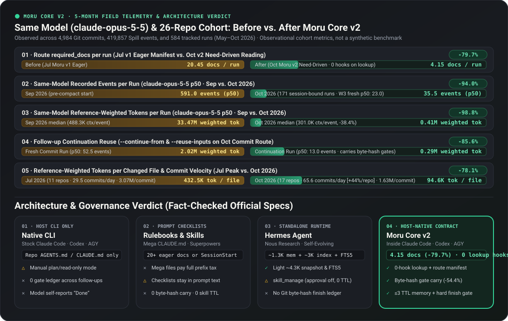

# 모루 코어 (Moru Core)

[한국어](README.ko.md) · [English](README.md) · [日本語](README.ja.md) · [简体中文](README.zh-CN.md)

모루 코어는 AI 코딩 에이전트가 일하는 순서와 완료 기준을 잡아 주는 공통 규칙입니다. 한 번 연결해 두면 Claude Code, Codex, Antigravity 같은 에이전트가 어느 프로젝트에서든 **할 일에 필요한 문서만 골라 읽고, 이미 통과한 테스트는 이어 쓰며, 테스트와 안전 점검이 끝난 뒤에야 “완료”라고 보고**합니다. 우리 프로젝트만의 고유한 규칙은 각 저장소에 짧게 적어 두고, 언제나 프로젝트 규칙이 가장 먼저 적용됩니다.

- 저장소: <https://github.com/taehwandev/moru-core>
- 사이트: <https://getmoru.com/core> · [왜 모루 코어인가 · 5개월 실측 리포트](https://getmoru.com/report)
- 스킬 디렉터리 (`skills.sh`): <https://www.skills.sh/taehwandev/moru-core>
- 릴리스: <https://github.com/taehwandev/moru-core/releases> · 릴리스 노트는 [`.github/release-notes/`](.github/release-notes/)

에이전트가 읽는 기준 문서는 [AGENTS.md](AGENTS.md)와 영문 공통 지침이며, 이 문서는 사람을 위한 한국어 안내입니다.

## 하는 일

- **쓰던 도구를 그대로 씁니다**: Claude Code, Codex, Antigravity를 바꿀 필요 없이 짧은 연결 문구만 넣어 그대로 씁니다.
- **할 일에 필요한 문서만 읽습니다**: 규칙 문서 20개를 매번 통째로 읽는 대신, 지금 맡긴 작업에 꼭 필요한 문서 몇 개만 골라 읽습니다.
- **말뿐인 완료가 아니라 실제 확인 기록을 남깁니다**: 테스트, 코드 검토, 안전 점검을 실제로 통과했는지 로컬 기록으로 남긴 뒤에야 작업을 마무리합니다.
- **프로젝트 규칙은 프로젝트에 둡니다**: 빌드·테스트 명령, 폴더 구조, 비밀키 관리 같은 프로젝트 고유 규칙은 각 저장소에 둡니다.
- **수정 전후 안전 점검을 기본으로 거칩니다**: [VibeGuard](https://vibeguard.thdev.app/)(모루 가드)가 코드 수정 전과 완료 전에 비밀키 유출이나 위험한 변경을 점검합니다.

런타임 구성: 런처 `~/.moru/bin/moru-hook`, 설정 `MORU_*`, 문서 내 경로 표기 `<MORU_ROOT>`/`<MORU_LAUNCHER>`, 로컬 기록 폴더 `.moru`, 보조 에이전트 역할 `moru_explorer`/`moru_worker`/`moru_reviewer`.

## 왜 모루 코어인가 (다른 방식과의 차이 & 5개월 실제 사용 결과)



코딩 에이전트에게 실제 프로젝트 일을 맡기다 보면 금방 세 가지 문제가 생깁니다.
1. **규칙을 `CLAUDE.md`에 길게 적어 둘수록 토큰만 빨리 닳습니다.** 단순한 질문을 하나 해도 배포 규칙과 커밋 규칙까지 매번 함께 읽히기 때문입니다.
2. **새 창을 열 때마다 똑같은 테스트와 똑같은 시행착오를 반복합니다.** 방금 통과한 테스트인데도 처음부터 다시 돌리고, 지난주에 겪은 버그 원인을 잊어버려 같은 자리를 또 헤맵니다.
3. **테스트가 깨져 있는데도 “다 고쳤습니다”라고 끝냅니다.** 또는 파일 하나에 900줄짜리 코드를 몰아넣어 사람이 검토하기 힘들게 만듭니다.

모루 코어는 지금 쓰는 코딩 에이전트 안에서 이 세 가지를 바로잡습니다.

| 비교 항목 | **모루 코어 (쓰던 CLI에 연결하는 규칙)** | 기본 코딩 CLI만 사용 (순정 Claude Code / Codex) | 긴 규칙 파일 & 프롬프트 팩 (대형 `CLAUDE.md` / `Superpowers`) | 별도 에이전트 프로그램 (예: Hermes Agent) |
| --- | --- | --- | --- | --- |
| **쓰던 도구를 바꿔야 하나?** | **✓ 쓰던 Claude Code·Codex·AGY 안에서 그대로 작동** | ✓ 쓰던 CLI 그대로 사용 | △ 쓰던 CLI + 거대한 규칙 파일이나 시작 프롬프트 추가 | △ 별도 에이전트 프로그램과 자체 터미널 환경을 새로 써야 함 |
| **필요한 규칙을 찾는 방식** | **✓ 라우트 계약 + Wikimap**: 라우트 계약이 필수 문서만 선택(`small-change`/`commit`/`cleanup` `2.0~2.3개`, 표준 라우트 `4~5개`), 미해결 질문 탐색은 **Wikimap(LLM 토큰 0개·로컬 섹션 인덱스)** 으로 보조 | △ 프로젝트 기본 파일 하나만 읽고(경로별 규칙 별도 설정 없을 시) 나머지는 시행착오로 찾음 | ✕ 문서 20개 분량을 매번 통째로 읽음 (스킬 팩은 필요 시 로딩) | △ 전체 스킬 목록(`~3K`)을 매번 프롬프트에 싣고, 필요한 스킬이나 예전 대화는 모델이 추가 턴·토큰을 써서 검색·요약 |
| **단순한 질문** *(“왜 이 API만 느려?”)* | **✓ 절차 없이 바로 답변**: 브랜치 생성이나 워크플로 절차를 건너뛰고 관련 코드만 읽어 바로 답함 | △ 읽기 전용 모드를 내가 직접 켜고 꺼야 안전함 | ✕ 질문 하나에도 커밋·배포 규칙까지 다 같이 읽음 | △ 시작 메모를 붙인 채 일반 에이전트 세션을 그대로 실행 |
| **오래 써도 규칙이 안 꼬이는 이유** | **✓ 검증된 공용 규칙 갱신 + 만료일 온디맨드 메모**: 공용 규칙 수정은 리뷰·검증 후 공유 체크아웃 리포에 반영되고, 프로젝트 메모는 만료일(`--review-on`) 필수 + 필요 시 명시적 `recall`(최대 3건·1,200자)로만 조회 | △ 사람이 `CLAUDE.md`를 고치거나 만료일 없는 런타임 자동 메모리에 의존 | ✕ 고정된 문서라 스스로 배우지 못하고 유통기한 관리도 없음 | △ 별도 잠금·승인 설정이 없으면 테스트 검증이나 만료일 없이 스킬을 스스로 수정해 낡은 임시방편이 쌓일 수 있음 |
| **이어서 작업하거나 커밋할 때** | **✓ 입력이 같으면 통과한 검증을 재사용** (2026년 11월 로컬 실측 이어하기: `cleanup` `28→6턴`, `build` `74→13턴`, `small-change` `16→9.5턴`, `commit` `35.5→27턴`) | ✕ 직전에 어떤 테스트를 통과했는지 기록이 남지 않음 | ✕ 프롬프트에 적힌 확인 목록을 처음부터 다시 반복함 | ✕ 이전 대화 내용은 검색하지만 코드 파일이 그대로인지는 대조하지 못함 |
| **언제 ‘완료(Done)’로 인정하나?** | **✓ 확인이 끝나야 완료 허용**: 필수 게이트 통과, 증분 개발 파일당 `300줄` 추가 기본 기준(테스트·초기 빌드 예외), 안전 점검 통과를 확인한 뒤 완료 허용 | ✕ 별도 훅이나 스크립트를 안 짜 두면 에이전트가 끝났다고 말하면 끝남 | △ 프롬프트로만 당부하는 방식이라 대화가 길어지면 빼먹기 쉬움 | △ 샌드박스와 메신저 연동은 좋지만 완료 판단은 모델 스스로 내림 |

### 수정 이후 정상 운영 실측 (2026년 10월 ~ 11월)

> **정직한 기준 및 트레이드오프:** 단순 1회성 수정만 보면 규칙 문서 0개·훅 0회인 **순정(Pure) CLI가 토큰을 덜 씁니다.** 모루 코어는 소량의 규칙·훅 오버헤드를 치르는 대신, 다단계 작업에서의 재작업·테스트 누락·구조 붕괴·보안 사고를 줄이는 트레이드오프입니다. 규칙 문서 20여 개를 통째로 로딩하던 초기(2026년 7월) 수치는 코어 자체 설정 결함이었으므로 제외하고, 아래에는 **수정 완료 후 정상 운영 기간(2026년 10~11월)**의 로컬 35개 프로젝트 실측(`11월 180런`, Spill 매칭 `158런`: `fresh 82`, `continuation 76`)만 정리합니다.

- **11월 정상 운영 중앙값 (`p50`, `n = 158` 매칭 런)**:
  - 경량 라우트: `small-change`(필수 문서 `2.1~2.3개`, `fresh 16.0턴` / `이어하기 9.5턴`, `0.27~0.37M`), `cleanup`(`1.8~2.0개`, `28.0턴` / `6.0턴`), `commit`(`2.0~2.1개`, `35.5턴` / `27.0턴`).
  - 주요 모델(`p50`): `gemini-4-neon` fresh(`n=32`: `10.0턴`, `0.35M`), `gemini-4-carbon` fresh(`n=4`: `14.0턴`, `0.49M`), `claude-sonnet-5-5` fresh(`n=7`: `22.0턴`, `0.85M`), `gpt-6.1-sol` fresh(`n=9`: `35.0턴`, `1.03M`).
  - 동일 모델(`claude-opus-5-5`, 10월 vs 11월): 10월 리포트 중앙 `35.5턴`(`0.41M`) vs 11월 `fresh`(`n=17`) `38.0턴`(`1.01M`), 11월 `이어하기`(`n=24`) `28.0턴`(`0.67M`), 11월 4주 `fresh`(`n=6`) `19.5턴`(`0.35M`).
- **저장소에서 재현 가능한 미시 실험**:
  - 시작 시 메모리 스캔·주입 제거: 3,000건 합성 저장소에서 헬퍼 중앙값 **`282.94ms → 26.96ms`(-90.5%)** (`docs/experiments/project-memory-start-references-2026-10-24.md`).
  - 동일 코퍼스 반복 문서 열기 제거: 미열람 문서 **`14 → 7회`**, 재사용 입증 문서 **`7 → 0회`** (`docs/maintenance-audit.md`).
- **11월 데이터에서 확인된 남은 과제**: `feature`(`7.25개`)·`bugfix`(`9.33개`) 라우트의 필수 문서 수가 다시 무거워졌고, `feature` 이어하기(`45.5턴`)는 후속 범위가 커지면 초기 `fresh`(`11.0턴`)보다 길어질 수 있습니다.

### 왜 모루 코어는 컨텍스트가 썩지 않을까요?

고정 규칙 파일은 어제의 실수에서 배우지 못하고, 반대로 검증이나 만료일 없이 에이전트가 자기 규칙을 고치게 두면 낡은 지침이 쌓여 컨텍스트가 오염됩니다. 모루 코어는 학습 범위를 통제하고 검증합니다.

1. **만료 날짜가 붙은 온디맨드 프로젝트 메모 (조회당 최대 3건·1,200자)**: 코드만 봐서는 알기 어려운 버그 원인이나 주의사항을 찾으면 **필수 만료 날짜(`--review-on`)**, 선택적 적용/제외 조건(`--applies-when` / `--not-when`), 소스 파일 해시 고정(`--source-path`)을 붙여 `project-memory`로 저장합니다. 작업 시작(`start`) 때는 메모리를 자동 스캔·주입하지 않으며, 필요할 때 명시적 `project-memory recall`로만 **최대 3건(1,200자)**을 불러와 시작 속도와 프롬프트 깔끔함을 유지합니다.
2. **반복 실수를 공용 규칙으로 검증 반영**: 여러 프로젝트에서 반복되는 실수나 차단 패턴은 리뷰와 검증(`workflow validate`·단위 테스트)을 거쳐 공용 규칙에 반영하며, 공유 체크아웃을 쓰는 저장소는 다음 `git pull`부터 즉시 새 규칙을 적용받습니다(서브모듈 고정 프로젝트는 태그 갱신 시 반영, `repair-verify`는 별도의 실패 체크포인트 1회 복구 영수증입니다).

내 맥(Mac)에 쌓인 월별·주차별 효율 변화는 아래 명령어로 언제든 직접 확인할 수 있습니다(프롬프트 내용이나 파일 경로는 외부로 나가지 않습니다):

```bash
python3 scripts/agent-os-status.py --efficiency-trends --all-projects --month 2026-11
```

이전 5개월 기록은 <https://getmoru.com/report> 에서 확인할 수 있습니다.

> **⚡ Powered by [Wikimap](https://github.com/dhha22/wikimap) — LLM 토큰 0개로 동작하는 로컬 마크다운 검색 인덱스**
> 작업별 필수 문서는 결정적 라우트 계약이 미리 선택하고, 미해결 분석·지침 질문에서 수백 개 마크다운 문서 중 필요한 문단을 찾을 때 모루 코어는 LLM 토큰을 쓰지 않는 **[Wikimap](https://github.com/dhha22/wikimap)**(장애 시 로컬 스코어러 폴백)을 사용합니다.
> - **LLM 호출 0회 · 로컬 증분 인덱싱**: 외부 벡터 DB나 모델 호출 없이 파이썬 표준 라이브러리 파일 하나로 동작하며, 변경된 파일을 로컬에서 증분 파싱합니다.
> - **한·일·중(CJK) 대응 섹션 검색 & 다중 질의 결합(RRF)**: 문서를 통째로 읽지 않고도 제목·헤딩·태그·별칭(`aliases`) 단위로 관련 섹션 후보를 찾아냅니다.
> - **문서 연결망(Link Graph) 추적**: 문서 간 참조(`outlinks`/`backlinks`/`REQ-ID`)를 추적합니다.
> 👉 **[GitHub에서 Wikimap 살펴보기 (`dhha22/wikimap`) ↗](https://github.com/dhha22/wikimap)**

## 시작하기

내 컴퓨터에 이미 받은 모루 코어가 있거나 팀 저장소에 연결된 복사본이 있다면 그대로 재사용합니다. 새로 받기 전에는 항상 사용자에게 먼저 물어봅니다.

```bash
git clone https://github.com/taehwandev/moru-core.git ~/.moru/core   # 개인 공유 설치 (1회)
python3 ~/.moru/core/scripts/setup-agent-hooks.py                     # 에이전트 연결 설정
<MORU_LAUNCHER> workflow validate
<MORU_LAUNCHER> doctor --project <대상 저장소>                          # 연결 상태 점검 (읽기 전용)
```

팀원들과 같은 버전을 고정해서 쓰고 싶다면 저장소 관리자와 상의해 서브모듈로 추가할 수도 있습니다.

```bash
git submodule add https://github.com/taehwandev/moru-core.git .agents/moru-core
```

### `skills.sh` (`npx skills`)로 설치하기

[`skills.sh`](https://www.skills.sh/taehwandev/moru-core)를 통해 **모루 코어 전체 엔진 연결 스킬(`moru-core`)**을 설치하거나, 모루 코어 없이 단독으로도 바로 쓸 수 있는 **엄선된 14개 간판 범용 스킬**(`human-authored-writing`, `figma-handoff`, `ambiguity-gate`, `code-review`, `bugfix-debugging`, `public-discovery`, `git-history-investigation` 등)만 골라서 설치할 수도 있습니다. (나머지 153개 플랫폼·내부 카드는 모루 코어 라우터가 필요할 때만 불러오도록 기본 목록에서 숨겨져 있습니다.)

```bash
# 모루 코어 전체 엔진(라우터 + VibeGuard) 연결 스킬 설치
npx skills add taehwandev/moru-core --skill moru-core

# 공개된 15개 간판 스킬 목록 확인 및 개별 스킬 골라 설치하기
npx skills add taehwandev/moru-core --list
npx skills add taehwandev/moru-core --skill human-authored-writing
```

모루 코어 업데이트는 작업 중이 아닐 때 `git pull --ff-only`와 `workflow validate`로 실행합니다. 자세한 방법은 [기존 설치 최신화 안내](docs/ko/update-moru.md)를 참고하세요.

## 내 프로젝트에 연결하기

1. 프로젝트에 이미 있는 `AGENTS.md`, `CLAUDE.md`, `CODEX.md` 파일을 먼저 확인합니다.
2. [연결 템플릿](templates/repo-agents-routing.md)의 짧은 안내 문구를 에이전트가 읽는 파일(가급적 `AGENTS.md`)에 추가합니다.
3. Git에 커밋되는 파일에는 내 개인 폴더 경로 대신 `<MORU_ROOT>`, `${MORU_HOME}`, `.agents/moru-core`처럼 어디서나 동작하는 경로 표기를 씁니다.
4. VibeGuard(모루 가드)가 모루 코어 규칙을 기준으로 안전 점검을 돌리도록 연결합니다.

직접 설정하는 대신 AI 에이전트에게 바로 시키고 싶다면, 프로젝트 폴더에서 에이전트를 열고 아래 문장을 그대로 붙여넣으세요:

```text
이 프로젝트에 모루 코어를 적용해줘: https://github.com/taehwandev/moru-core
이미 컴퓨터에 설치된 모루 코어가 있으면 그걸 쓰고, 새로 받아야 하면 먼저 물어봐줘.
이 저장소의 기존 지침 파일과 VibeGuard 설정을 먼저 읽고 바꾸기 전에 확인해줘.
AGENTS.md에 짧은 연결 블록을 추가하고 우리 프로젝트 고유 규칙은 그대로 유지해줘.
```

전체 요청문은 [적용 요청 템플릿](templates/apply-moru-request.md)에 있습니다.

## 실제 작업이 돌아가는 순서

코드를 고치지 않는 단순 질문은 별도 절차 없이 관련 코드를 찾아 바로 답합니다.
파일을 수정하는 작업은 런처를 통해 아래 순서로 진행됩니다.

```bash
<MORU_LAUNCHER> start --project <대상 저장소> --rules <MORU_ROOT> \
  --command < 작업 종류 > --request "<사용자 요청>" \
  --intent <짧은_분류명> --target-summary "<작업 대상 요약>"
```

1. **시작(`start`)**: 요청 내용에 맞는 작업 경로(`small-change`, `bugfix`, `feature`, `docs` 등)와 권한 범위를 정합니다.
2. **필요한 문서만 읽기**: 해당 작업에 꼭 필요한 문서(`required_docs`)만 읽습니다.
3. **작업 및 확인 기록(`gate-batch`)**: 코드를 수정하고 테스트 결과를 기록합니다. 언제든 `<MORU_LAUNCHER> next`를 실행하면 다음 할 일과 명령어를 알려 줍니다.
4. **검토(`review`) 및 완료 확인(`finish`)**: 변경된 코드 크기(개발 파일 추가 300줄 이내)와 안전 점검을 확인한 뒤, 빠진 검사가 없을 때만 완료하고 커밋합니다.

검사 결과는 `🐱🟢 SUCCESS`와 `🐱🔴 FAIL`로 명확히 표시됩니다. 하던 작업을 이어서 할 때는 `start --continue-from <이전 작업 ID>`로 직전 확인 결과를 이어받습니다. 찾아낸 원인은 프로젝트 메모(`project-memory`)에, 남은 할 일은 작업 카드(`work-cards`)에 기록됩니다([자세히 보기](docs/project-memory.md)).

## 함께 쓰는 모루 생태계 도구

- **[VibeGuard](https://vibeguard.thdev.app/) (모루 가드)**: 모루 코어 규칙을 기준으로 코드 수정 전과 완료 전에 비밀키 유출과 위험한 변경을 점검합니다.
- **[Wikimap](https://github.com/dhha22/wikimap)**: LLM 토큰을 하나도 쓰지 않고 0.1초 만에 지금 작업에 필요한 규칙 문서만 골라 줍니다.
- **[Spill](https://getmoru.com/spill)**: 내 맥(Mac)에서 코딩 에이전트의 토큰 사용량과 작업 흐름을 집계하며, 모루 코어 설치 시 작업 라벨이 자동으로 연결됩니다.
- **[Moru Artemis (`moru-artemis`)](https://github.com/taehwandev/moru-artemis)**: Claude Code·Codex·Antigravity가 연결된 안드로이드 실기기와 에뮬레이터를 MCP로 직접 조작하게 해 주는 오픈소스 어댑터(`google/artemis` 기반 Apache-2.0 포크)입니다. 별도 유료 LLM API 키 없이 호스트 에이전트가 직접 화면을 판단하며, 원본 XML 대비 **-96.4% 가벼운 컴팩트 UI 트리(`~0.19초`)**, 애니메이션 종료 대기(`wait_for_stable`), 스크롤 끝·이동량(`scroll_end_reached`/`moved`) 자동 감지를 지원합니다.

## SkillSpector로 점검한 기록

2026년 10월 26일 [NVIDIA SkillSpector](https://github.com/NVIDIA/SkillSpector)
2.12.0의 고정된 소스 버전으로 현재 스킬 168개를 직접 정적 검사했습니다.
이번 검사에 사용한 도구이며, 모루의 필수 실행 의존성이나 NVIDIA 인증은 아닙니다.

- 정적 스캐너는 LLM 호출과 경고 숨김 없이 실행했고, Claude의 독립 검토는 별도로 진행했습니다.
- 옛 문서 참조 85곳과 실제 경로를 놓치던 검증기를 고쳤습니다.
  참조 검사 31개를 포함한 관련 테스트 177개가 통과했습니다.
- 원시 탐지 로그 652건에는 정상적인 참조와 금지문 예시도 포함됩니다.
  미해결 취약점 개수가 아닙니다. 완전 검사 112개·부분 검사 56개이며,
  도구의 SAFE 97개·CAUTION 66개·DO_NOT_INSTALL 5개 판정을 그대로 기록했습니다.
- 도구의 분석 한계가 남은 문서 4개와 버전이 고정되지 않은 최신 패키지 실행 정책은
  실제로 보완한 결함과 구분해 공개합니다.
- 앞선 작업에서는 운영 지침을 명확히 하고, 별도 코드 검토에서 재현한 OpenRouter
  인증 헤더의 리다이렉트 전달 경로를 차단했습니다. 가짜 키를 사용한 동작
  테스트로 확인했으며, 과거에 실제 유출이 있었다는 뜻은 아닙니다.

[검사 범위·원시 로그·문맥 검토·파일 해시·검증 기록](docs/security/skillspector-2026-10-26/README.md)을
함께 공개할 수 있도록 보관합니다. 이 기록은 보고서에 명시한 기준 커밋과 수정 작업본에
대한 것이며, 이후 모든 버전·운영 웹사이트·AI 도구 전체의 안전을 보증하거나
지속적인 자동 검사가 실행 중이라는 뜻은 아닙니다.

## 폴더 구성

- `AGENTS.md`: 에이전트가 가장 먼저 읽는 공통 시작 문서
- `common/`: 언어·플랫폼에 상관없이 적용되는 기본 개발 규칙
- `platforms/`: Android, iOS, 웹, 서버, Python 등 플랫폼별 가이드
- `product-patterns/`: 로그인, 초대, 결제, 권한 등 자주 쓰는 기능 패턴
- `workflows/`: 작은 수정, 기능 개발, 버그 수정, 배포 등 상황별 작업 순서
- `scripts/`: 작업 시작·검토·완료 확인을 돕는 실행 스크립트
- `templates/`: 프로젝트에 붙여넣기만 하면 되는 연결 템플릿

릴리스 버전은 한국 달력(월요일 시작 주차) 기준 주간 버전인 `vYY.WW.N` 형식을 사용합니다.
