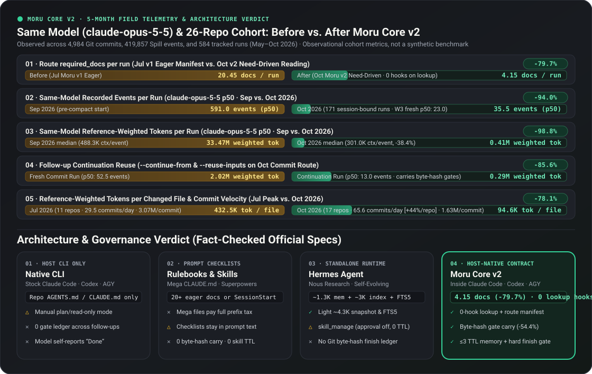

# Moru Core

[English](README.md) · [한국어](README.ko.md) · [日本語](README.ja.md) · [简体中文](README.zh-CN.md)

Moru Core is a shared set of working rules and completion checks for AI coding
agents. Connect it once, and Claude Code, Codex, Antigravity, and other agents
follow the same standards across all of your repositories—reading only the
guidance a task needs, reusing passed tests when code has not changed, and
verifying their work before calling it done. Your project's own instructions
stay short and always have the final say.

- Repository: <https://github.com/taehwandev/moru-core>
- Website: <https://getmoru.com/core> · [Why Moru Core & 5-Month Report](https://getmoru.com/report)
- Skills Directory (`skills.sh`): <https://www.skills.sh/taehwandev/moru-core>
- Releases: <https://github.com/taehwandev/moru-core/releases> · release notes in [`.github/release-notes/`](.github/release-notes/)

## What It Does

- **Works in the tools you already use.** The same rules work across Claude
  Code, Codex, and Antigravity/AGY through a short connection block.
- **Reads only what the task needs.** Instead of dumping 20 rule files into
  every prompt, the agent opens only the few documents relevant to the current
  task.
- **Verifies before “Done.”** A local launcher records which tests, code
  reviews, and safety checks actually ran—turning “I checked it” from a claim
  into a verified record.
- **Keeps project rules in the project.** Build commands, paths, product policy,
  and secrets stay in your repository, never here.
- **Built-in safety checks.** [VibeGuard](https://vibeguard.thdev.app/) (Moru
  Guard) runs before edits and before completion using Moru Core as its rule
  source.

Runtime names: launcher `moru-hook` in `~/.moru/bin`, `MORU_*` settings,
`<MORU_ROOT>`/`<MORU_LAUNCHER>` placeholders in committed docs, `.moru` local
state, and the `moru_explorer`/`moru_worker`/`moru_reviewer` agent roles.

## Why Moru Core (How It Compares & 5-Month Real-World Results)



When you work with coding agents every day, three problems show up fast:
1. **Stuffing every rule into `CLAUDE.md` or `AGENTS.md` burns tokens on every turn**—even when you just ask a simple question.
2. **Agents repeat the same tests and mistakes across sessions** because they do not keep a record of which files were already tested or why a bug happened last week.
3. **Agents say “Done” while a test is still broken** or after writing a 900-line file that nobody wants to review.

Moru Core solves those three problems right inside your existing CLI:

| What you care about | **Moru Core (Rules Inside Your CLI)** | Stock Coding CLI (Plain Claude Code / Codex) | Long Rulebooks & Skill Packs (Giant `CLAUDE.md` / `Superpowers`) | Separate Agent App (e.g., Hermes Agent) |
| --- | --- | --- | --- | --- |
| **Do I have to switch tools?** | **✓ Keep Claude Code, Codex, or AGY** just as you use them today | ✓ Keep your current CLI | △ Keep your CLI, plus a giant rule file or startup prompt pack | △ Switch to a separate agent runtime and terminal setup |
| **How needed rules are found** | **✓ Route contracts + Wikimap**: deterministic route contracts pick only the required docs for each route (`2.0–2.3` docs for `small-change`/`commit`/`cleanup`, `4–5` for standard routes), and **Wikimap (`0` LLM tokens, local section index)** handles on-demand reference search for unresolved questions | △ Only the repo's main instruction file (unless path-scoped rules are configured); figures out the rest by trial and error | ✕ A 20-file rulebook pays the full token cost every turn (skill packs load on demand) | △ Carries the full skill list (`~3K` tok) every session + spends extra LLM turns to open skills or summarize raw chat logs |
| **Asking a simple question** *(“Why is this API slow?”)* | **✓ Answers right away**: skips branch creation and workflow steps, reads the code, and leaves your files untouched | △ Safe if you switch to read-only/plan mode yourself | ✕ Still loads commit and release rules just to answer a question | △ Runs a full agent session with its startup memory attached |
| **How it learns without rotting** | **✓ Reviewed shared fixes + expiring on-demand notes**: shared rule fixes are reviewed and verified before syncing across shared-checkout repos, and project notes require an expiry date (`--review-on`, optional `--applies-when`/`--not-when`, explicit `recall` capped at 3 notes / 1,200 chars) | △ Manual `CLAUDE.md` edits or runtime auto-memory without expiry dates | ✕ Static markdown files never learn from mistakes or expire | △ Model can rewrite its own skills (`skill_manage`) without test verification or expiry dates unless locked/approved |
| **Following up & committing** | **✓ Reuses passed checks** when the relevant inputs haven't changed (in Nov 2026 local data: `cleanup` `28 → 6` turns, `build` `74 → 13` turns, `small-change` `16 → 9.5` turns, `commit` `35.5 → 27` turns on continuation) | ✕ Forgets what was already tested in the last run | ✕ Re-runs the whole checklist from the prompt | ✕ Searches old chat text, but doesn't check if code files changed |
| **When is a task allowed to be “Done”?** | **✓ Checks the result first**: blocks completion until required gates pass, incremental dev files stay within the `300`-added-line per-file default (tests/initial builds excepted), and safety checks pass | ✕ Whenever the model says it's done (unless you build custom scripts or hooks) | △ Checklist in the prompt—easy for the model to skip in long chats | △ Great sandboxes and chat bots, but the model still decides when it's done |

### Post-Fix Operational Snapshot (October – November 2026)

> **Honest baseline & tradeoff:** On a trivial one-off edit, a pure/vanilla CLI uses fewer tokens because it loads zero rule docs and runs zero lifecycle hooks. Moru Core trades a small upfront rule/hook overhead for verified completion gates, structure limits, and fewer rework loops across multi-step work. Earlier July 2026 metrics (when Moru Core loaded ~20 rule files up front) reflected a self-inflicted configuration defect rather than a steady-state baseline, so the snapshot below focuses on **post-fix operation (October–November 2026)** across our own `35` local projects (`180` November runs, `158` Spill-matched: `82` fresh, `76` continuation).

- **Steady-state turns & weighted tokens (`2026-11`, `n = 158` matched runs, median `p50`)**:
  - Lightweight routes stay lean: `small-change` (`2.1–2.3` required docs; `16.0` fresh / `9.5` continuation turns; `0.27–0.37M` weighted tokens), `cleanup` (`1.8–2.0` docs; `28.0` fresh / `6.0` continuation turns), `commit` (`2.0–2.1` docs; `35.5` fresh / `27.0` continuation turns).
  - By model (`p50`): `gemini-4-neon` fresh (`n = 32`: `10.0` turns, `0.35M`), `gemini-4-carbon` fresh (`n = 4`: `14.0` turns, `0.49M`), `claude-sonnet-5-5` fresh (`n = 7`: `22.0` turns, `0.85M`), `gpt-6.1-sol` fresh (`n = 9`: `35.0` turns, `1.03M`).
  - Same model (`claude-opus-5-5`, Oct → Nov): October report median `35.5` turns (`0.41M`) vs. November `fresh` (`n = 17`) `38.0` turns (`1.01M`), November `continuation` (`n = 24`) `28.0` turns (`0.67M`), and November Week 4 `fresh` (`n = 6`) `19.5` turns (`0.35M`).
- **Reproducible micro-benchmarks in this repo**:
  - Removing start-time memory scan/injection cut the helper median from **`282.94 ms → 26.96 ms`** (`-90.5%`, 3,000-record synthetic store; see `docs/experiments/project-memory-start-references-2026-10-24.md`).
  - Deduplicating repeated doc opens on the same corpus cut unread opens **`14 → 7`** and verified-reused opens **`7 → 0`** (see `docs/maintenance-audit.md`).
- **Open gaps visible in November data**: `feature` (`7.25` docs) and `bugfix` (`9.33` docs) still carry heavier required-doc sets than lightweight routes, and continuation on `feature` (`45.5` turns) can run longer than initial `fresh` slices (`11.0` turns) when follow-up scope expands.

### Why Moru Core Stays Bounded Without Prompt Rot

Static rule files never learn from yesterday's bugs. On the other hand, letting an agent rewrite its own skills without review or expiration dates quickly fills your context with outdated advice. Moru Core keeps learning bounded and reviewable:

1. **Short on-demand project notes with an expiration date (at most 3 per recall)**: When an agent tracks down a tricky root cause or project quirk that isn't obvious from the code, it saves a short note (`project-memory`) with a required review date (`--review-on`), optional applicability cues (`--applies-when` / `--not-when`), and optional Git blob hash pinning (`--source-path`). Task `start` never auto-scans or injects memory; instead, agents run explicit `project-memory recall` only when needed, capped at **3 relevant, unexpired notes (1,200 chars)**—keeping startup fast and prompts clean.
2. **Fix a recurring mistake once, and every shared checkout gets it**: When the same kind of mistake or blocked step happens repeatedly across projects, fixing and verifying the shared rule through reviewed maintenance (`workflow validate` / unit tests) lets every connected shared checkout pick it up on its next `git pull` (pinned submodules upgrade when their teams bump the tag; `repair-verify` separately handles one-shot failed-checkpoint recovery).

You can inspect your own monthly and weekly efficiency trends anytime (no prompts or file paths are ever exported):

```bash
python3 scripts/agent-os-status.py --efficiency-trends --all-projects --month 2026-11
```

Historical 5-month background report: <https://getmoru.com/report>.

> **⚡ Powered by [Wikimap](https://github.com/dhha22/wikimap) — Zero-LLM Knowledge Index for Markdown**
> Deterministic route contracts pick each task's required docs up front, and when an agent needs to look up an unresolved guidance or analysis question across hundreds of Markdown files without burning a single LLM token, Moru Core uses **[Wikimap](https://github.com/dhha22/wikimap)** (with a local scorer fallback):
> - **0 LLM tokens & incremental local indexing**: Single Python stdlib file with no external vector DB or model calls; re-parses modified files locally instead of rebuilding everything from scratch.
> - **CJK-safe ranked section search & Reciprocal Rank Fusion (RRF)**: Matches exact headings, tags, aliases, and sections across Korean, Japanese, Chinese, and English without loading whole files.
> - **Link graph & freshness tracking**: Tracks `outlinks`, `backlinks`, and `REQ-ID` references across documents.
> 👉 **[Explore Wikimap on GitHub (`dhha22/wikimap`) ↗](https://github.com/dhha22/wikimap)**

## Quick Start

Reuse an existing checkout when one is on your machine or pinned in the repo. Do
not clone a second copy unless the user approves it after being told which root
was found.

**1. Download Moru Core once.** For a personal shared install:

```bash
git clone https://github.com/taehwandev/moru-core.git ~/.moru/core
```

If your team wants to pin a specific reviewed version inside a repository, add
it as a submodule after the repo owner approves:

```bash
git submodule add https://github.com/taehwandev/moru-core.git .agents/moru-core
```

**2. Set up the launcher and agent connections.**

```bash
python3 ~/.moru/core/scripts/setup-agent-hooks.py
```

This installs `~/.moru/bin/moru-hook` (shown as `<MORU_LAUNCHER>`), the
`~/.moru/moru-root` pointer, and the short connection blocks for Codex, Claude,
and AGY. You can check or repair the setup anytime with
`<MORU_LAUNCHER> setup-agent-hooks --check` and
`<MORU_LAUNCHER> setup-agent-hooks`.

For optional native checkout lookup and status rendering without installing
Rust/Cargo on the receiving computer, use the [prebuilt bundle guide](docs/native-runtime-install.md).
Installation bundles are available on [GitHub Releases](https://github.com/taehwandev/moru-core/releases/latest)
without the seven-day CI artifact expiry. Python and Git remain required for the rest of Core.

**3. Check that everything is ready.**

```bash
<MORU_LAUNCHER> workflow validate
<MORU_LAUNCHER> doctor --project <TARGET_REPO>   # read-only health check
```

### Install via `skills.sh` (`npx skills`)

You can also install Moru Core's full-engine bootstrap skill (`moru-core`) or any of its **14 curated standalone skills** (`human-authored-writing`, `figma-handoff`, `ambiguity-gate`, `code-review`, `bugfix-debugging`, `public-discovery`, `git-history-investigation`, and more) directly via [`skills.sh`](https://www.skills.sh/taehwandev/moru-core):

```bash
# Connect Moru Core's full workflow router & VibeGuard bootstrap skill
npx skills add taehwandev/moru-core --skill moru-core

# List all 15 curated public skills or install a standalone skill
npx skills add taehwandev/moru-core --list
npx skills add taehwandev/moru-core --skill human-authored-writing
```

**Updating:** Pull updates between tasks (never in the middle of one) so rules
stay consistent during a run:

```bash
cd ~/.moru/core && git pull --ff-only && <MORU_LAUNCHER> workflow validate
```

Connected repositories automatically use the updated rules without needing
commits of their own. Release notes live in
[`.github/release-notes/`](.github/release-notes/).

## Connect A Project

1. Read the project's existing `AGENTS.md`, `CLAUDE.md`, `CODEX.md`, or
   `.agents/` instructions first.
2. Add the short routing block from
   [`templates/repo-agents-routing.md`](templates/repo-agents-routing.md) to the
   file your agent reads (preferring `AGENTS.md`).
3. Keep committed paths portable: use `<MORU_ROOT>`, `${MORU_HOME}`, or a
   relative submodule path like `.agents/moru-core`—never your personal home
   directory path.
4. Run VibeGuard with Moru Core as the rule source:

   ```bash
   npx --yes @taehwandev/vibeguard@latest audit . --rules <MORU_ROOT>
   ```

More details on multi-repo workspaces and setup:
[agent bootstrap](docs/skills/agent-bootstrap/SKILL.md) and
[runtime setup](docs/skills/agent-runtime-integration/references/runtime-setup.md).

## Apply With Any AI Agent

Want your agent to set this up for you? Paste this into your coding agent inside
the project:

```text
Apply Moru Core to this project: https://github.com/taehwandev/moru-core
Reuse an existing local copy if there is one; ask before downloading another.
Read this repo's instructions and VibeGuard files first and ask before
replacing them. Use the Moru Core root as the VibeGuard rule source. Add the
short routing block to AGENTS.md and keep repo-specific rules in this repo.
```

Full template: [`templates/apply-moru-request.md`](templates/apply-moru-request.md).
For a one-time session without editing project files, use
[`templates/use-moru-prompt.md`](templates/use-moru-prompt.md).

## How A Task Runs

Questions that only read code are answered right away without starting a workflow.
When a task changes files, the agent runs it through the launcher:

```bash
<MORU_LAUNCHER> start --project <TARGET_REPO> --rules <MORU_ROOT> \
  --command <route> --request "<USER_REQUEST>" \
  --intent <safe_slug> --target-summary "<bounded target>"
```

1. **Start** picks the right workflow path (`small-change`, `bugfix`, `feature`,
   `docs`, etc.) and checks permissions. Pass `--approved-effect git_write` only
   when the user asked to commit or push.
2. **Read** the few `required_docs` selected for that workflow; open extra
   reference docs only if a question comes up.
3. **Work and record** test results with `<MORU_LAUNCHER> gate-batch`. Run
   `<MORU_LAUNCHER> next` anytime to see the next step and exact command.
4. **Review hook** checks the diff, file sizes, links, and VibeGuard safety rules.
5. **Finish hook** confirms all required checks passed before reporting done or
   committing.

Use the launcher for these steps. The lower-level route, preflight, and
finish-check scripts are diagnostics; they do not replace this lifecycle.

Check status is always `🐱🟢 SUCCESS` or `🐱🔴 FAIL`. To pick up an interrupted
task or do a follow-up, run `start --continue-from <run id>`. Mechanics and
recovery rules:
[scripted agent workflow](workflows/skills/scripted-agent-workflow/references/current-guidance.md)
and [executable evidence gate](docs/skills/agent-runtime-integration/references/executable-evidence-gate.md).

## Memory And Work Cards

When an agent confirms a non-obvious cause, pitfall, or design reason, it saves
a short note with `<MORU_LAUNCHER> project-memory` (with a required `--review-on`
date and optional `--source-path` Git blob hash pinning). Task `start` does not
auto-scan or inject memory; agents run explicit `project-memory recall` on demand,
returning up to three relevant, unexpired notes (capped at 1,200 characters).
Work cards keep unfinished tasks visible across sessions. Both stay local on your
machine. Details: [project memory and work cards](docs/project-memory.md).

## Supported Coding Agents & Companion Tools

- **Codex** and **Antigravity/AGY** read `AGENTS.md` directly (AGY also gets a
  `GEMINI.md` pointer).
- **Claude Code** reads `CLAUDE.md`, which imports `AGENTS.md`.
- Setup adds a short connection block to each tool's user settings and installs
  the `moru_*` helper roles.
- **[VibeGuard](https://vibeguard.thdev.app/)** runs pre-edit and pre-finish
  safety and secret checks using Moru Core as its rule source.
- **[Wikimap](https://github.com/dhha22/wikimap)** indexes Markdown sections
  locally (`0` LLM tokens) so each task loads only the few rules it needs.
- **[Spill](https://getmoru.com/spill)** tracks local token and session activity
  on your Mac; setup connects task labels automatically without extra hooks.
- **[Moru Narrow (`moru-narrow`)](https://github.com/taehwandev/moru-narrow)**
  is a zero-index Rust CLI (`moru-narrow` / `mnarrow`) that ranks `rg -w <Name>`
  hits into real `TIER 1` callers for Kotlin (Gradle), TypeScript, Python, and
  Rust contract changes, refactors, and call-site blast-radius checks.
- **[Moru Artemis (`moru-artemis`)](https://github.com/taehwandev/moru-artemis)**
  is an open-source Android MCP server (Apache-2.0 fork of `google/artemis`)
  that lets your coding agent inspect and control connected Android devices and
  emulators directly—with `0` secondary LLM API keys, `~0.19s` compact UI tree
  reads (`-96.4%` payload vs raw XML), stable-screen waiting, and automatic
  scroll-end detection.

Details: [agent runtime integration](docs/skills/agent-runtime-integration/SKILL.md).

## Repository Layout

```text
AGENTS.md         Main entrypoint read by coding agents
index.md          Document catalog
common/           General engineering rules
platforms/        Android, KMP, Flutter, iOS, Swift, React Native, web, server, Python, and app guides
product-patterns/ Reusable patterns for auth, invites, billing, and credentials
workflows/        Step-by-step workflows by task type
scripts/          Launcher, hooks, routers, and validators
templates/        Copy-paste setup blocks and prompts
docs/             Reference guides and runtime setup docs
```

Start most coding work from
[`common/skills/agent-operating-skill/SKILL.md`](common/skills/agent-operating-skill/SKILL.md).

## Recorded SkillSpector Inspection

We used [NVIDIA SkillSpector](https://github.com/NVIDIA/SkillSpector) for a
self-run static inspection on 26 October 2026; it is an audit tool used for this
inspection, not an installed Moru runtime dependency or NVIDIA certification.

- Pinned scanner: `2.12.0`, revision `d7338f58200a9ae2a24810cee08911ab68b107a7`.
- Current scope: 168 Core skill bundles, with no scanner LLM calls or suppression.
  Independent Claude review was a separate step.
- Repairs: 85 obsolete document references and a literal-path validation blind
  spot were fixed. The reference checker passes 31 tests; all 177 focused tests pass.
- The raw scanner log contains 652 pattern records, including normal references
  and prohibited examples; this is not an unresolved-vulnerability count.
  Coverage is 112 complete / 56 partial analyses. Original recommendations
  remain 97 SAFE / 66 CAUTION / 5 DO_NOT_INSTALL, with limitations recorded.
- Four document surfaces still hit scanner limits, and the mandated latest-package
  fallback remains unpinned. These are disclosed separately from repaired defects.
- Earlier work clarified operating guidance and separately reproduced and patched
  credential-forwarding on redirects in two optional OpenRouter adapters.
  Synthetic behavior tests verify the patch; this does not assert a past breach.

Read the [scope, raw findings, contextual review, hashes and verification](docs/security/skillspector-2026-10-26/README.md).
The report identifies the baseline and audited patch snapshot; it does not
claim every later revision, the deployed web app or native AI runtimes were
scanned. No automatic continuous scanning is implied.

## Contributing

- Shared rules are written in clear, concise English. Translated guides (such as
  [README.ko.md](README.ko.md), [README.ja.md](README.ja.md), and
  [README.zh-CN.md](README.zh-CN.md)) are for human readers; English files
  remain the source of truth for agents.
- Link to existing rules instead of copying them.
- Only add rules that apply across projects—keep project-specific names, paths,
  and policies in their own repositories.
- Every rule document includes frontmatter (`keyflow_id`, `status`, `type`) per
  [doc conventions](common/skills/doc-conventions/SKILL.md).

## Local Hook Testing

Run the end-to-end smoke checks in a temporary sandbox:

```bash
python3 scripts/run_smoke_checks.py
```

Unit tests: `PYTHONPATH=tests:scripts python3 -B -m unittest discover -s tests`.

## Moru Maintenance Audit

Health and efficiency checks for Moru Core itself live in
[docs/maintenance-audit.md](docs/maintenance-audit.md).

## Website Deployment

The public page is <https://getmoru.com/core>, deployed on Vercel as part of the
Moru website. Public releases are tagged for meaningful updates using weekly
CalVer `vYY.WW.N` on the Korean calendar (Asia/Seoul, Monday-start weeks); see
[web deployment versioning](common/skills/web-deployment-versioning/SKILL.md)
and [release versioning](common/skills/release-versioning/SKILL.md).
