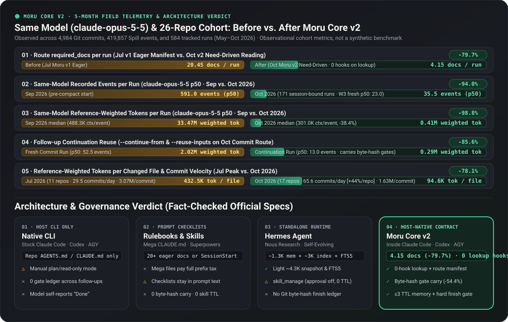

# Moru Core

[简体中文](README.zh-CN.md) · [English](README.md) · [한국어](README.ko.md) · [日本語](README.ja.md)

Moru Core 是为 AI 编程代理（Coding Agents）提供统一工作规范与完成检查的开源规则层。只需接入一次，Claude Code、Codex、Antigravity 等工具在你的所有代码仓库中都会遵循同一套标准：**只读当前任务需要的文档、在代码未改动时直接复用已通过的测试结果、并在测试与安全检查真正通过后才汇报“已完成（Done）”**。项目自身的规则保持精简，且始终具有最高优先级。

- 代码仓库: <https://github.com/taehwandev/moru-core>
- 官方网站: <https://getmoru.com/core> · [为什么选择 Moru Core · 5 个月实测报告](https://getmoru.com/report)
- 版本发布: <https://github.com/taehwandev/moru-core/releases> · 发布说明位于 [`.github/release-notes/`](.github/release-notes/)

代理直接读取的基准规范为 [AGENTS.md](AGENTS.md) 与英文公共指南。本文档是面向开发者的简体中文说明。

## 它能做什么

- **继续使用你顺手的工具**：无需更换 Claude Code、Codex 或 Antigravity，只需添加一小段连接说明即可直接工作。
- **只读当前任务需要的文档**：不再把 20 多篇规则文件一股脑塞进每次对话，而是只打开与当前任务相关的几篇必要文档。
- **用真实检查记录代替口头“已检查”**：本地启动器会记录实际运行过的测试、代码审查与安全检查，全部通过后才允许结束任务。
- **项目规则留在项目里**：构建命令、目录结构、业务策略与密钥配置都保存在各自的目标仓库中。
- **内置修改前后的安全检查**：[VibeGuard](https://vibeguard.thdev.app/)（Moru Guard）会在修改代码前与任务完成前自动检查密钥泄露和高风险操作。

运行时组件：启动器 `~/.moru/bin/moru-hook`、环境变量 `MORU_*`、文档占位符 `<MORU_ROOT>`/`<MORU_LAUNCHER>`、本地记录目录 `.moru`、辅助代理角色 `moru_explorer`/`moru_worker`/`moru_reviewer`。

## 为什么选择 Moru Core（与其他方式对比 & 5 个月真实数据）



在日常开发中把真实任务交给编程代理时，往往很快会遇到三个问题：
1. **往 `CLAUDE.md` 里写的规则越多，每轮消耗的 Token 就越夸张**——哪怕只是问一个简单问题，提交规范和发版流程也会跟着一起加载。
2. **每次新开会话都在重复跑相同的测试、踩相同的坑**——刚刚通过的测试又要重跑一遍，上周刚查明白的 Bug 原因到了新会话里又得重新排查。
3. **测试还没过就急着汇报“改好了”**，或者在一个文件里塞进 900 行代码，让人根本没法做代码审查。

Moru Core 直接在你现有的 CLI 工具里解决这三个问题：

| 你关心的重点 | **Moru Core (接入现有 CLI 的工作规范)** | 只用默认 CLI (原生 Claude Code / Codex) | 超长规则文件 & 提示词包 (巨型 `CLAUDE.md` / `Superpowers`) | 独立代理运行环境 (如 Hermes Agent) |
| --- | --- | --- | --- | --- |
| **需要换工具吗？** | **✓ 直接在现有的 Claude Code、Codex、AGY 中运行** | ✓ 继续用现有的 CLI | △ 继续用现有 CLI，但需附加超长规则或启动提示词 | △ 需要切换到独立的代理程序与专属终端环境 |
| **如何找到当前需要的规则？** | **✓ Wikimap（0 LLM Token、0.1 秒级章节索引）**：在模型盲目试探前直接精准挑出当前任务所需的平均 `4.15` 篇文档（较全量加载 `20.45` 篇减少 **-79.7%**） | △ 只读项目主说明文件，其余规范靠边试边找 | ✕ 每次对话都全量加载 20 多篇规则（或通过工具逐个加载） | △ 每次会话都携带完整技能目录（约 `3K`），且模型需额外消耗 LLM 轮次和 Token 去打开技能或搜索总结历史聊天 |
| **只问一个简单问题** *(“为什么这个 API 慢？”)* | **✓ 跳过繁琐流程直接回答**：不建分支、不跑流程，直接查看相关源码作答（自动拦截文件修改） | △ 需要自己手动切换到只读/计划模式才安全 | ✕ 哪怕只是提问，也会把提交和发布规则一起读进来 | △ 带着启动记忆走完一整套常规代理对话循环 |
| **为什么久用也不会规则腐化？** | **✓ 测试验证修复 + 到期日笔记**：公共规则必须通过实际测试（`repair-verify`）才会同步到全部 26 个仓库；项目笔记附带到期日（`--review-on`）与适用条件，每次最多调取 3 条（3 周内步骤减少 **-79.5%**） | ✕ 只能靠人工手动修改 `CLAUDE.md` | ✕ 静态 Markdown 文档不会自动总结经验，也没有过期清理机制 | △ 在没有测试验证和到期日的情况下由模型自动改写技能与记忆，错误的临时招数会永久留在提示词里 |
| **接着改或提交代码时** | **✓ 代码未改动时直接复用已通过的测试**（后续跟进步骤减少 **-54.4%**，提交阶段 Token 减少 **-85.6%**） | ✕ 记不住上一轮已经通过了哪些测试 | ✕ 按提示词里的清单从头再检查一遍 | ✕ 能搜索历史聊天记录，但无法核对代码文件是否发生变动 |
| **什么时候才算“完成（Done）”？** | **✓ 检查全部通过才允许完成**：测试通过、新增代码文件不超过 `300` 行、安全检查通过后，才允许标记完成 | ✕ 除非自己写钩子脚本，否则全凭模型自己宣布完成 | △ 靠提示词叮嘱，长对话里很容易被模型漏掉 | △ 沙箱和聊天机器人很强，但任务是否完成仍由模型自己判断 |

### 5 个月、26 个真实项目的日常使用变化（4,984 次 Git 提交 · 419,857 个执行步骤）

以下数据来自 2026 年 5 月至 10 月我们在 `26` 个代码仓库中的真实日常开发记录（共 `419,857` 条 Spill 事件、`1,207` 个 Codex 会话、`584` 次 Moru 任务）。我们在固定相同模型的前提下，对比了引入并完善 Moru Core 前后的实际表现：

- **每次任务读取的规则文档减少 -79.7%**（7 月全量加载时平均每次读 `20.45` 篇 → 10 月按需读取仅 `4.15` 篇）。
- **每次 Git 提交耗费的代理步骤减少 -60.7%**（`150.7` 步 → `59.2` 步），同时 **日均提交数提升 +122.4%**（单个活跃仓库日均提交从 `2.68` 次升至 `3.86` 次，**单项目产出速度提升 +44.0%**）。
- **每个修改文件的 Token 消耗降低 -78.1%**（从 7 月每文件 `432.5K` 降至 10 月 `94.6K`；单次提交 Token 消耗也从 `3.07M` 降至 `1.63M`，下降 **-46.9%**）。
- **Codex 单次会话 Token 中位数下降 -93.8%**（`20.28M` → `1.25M`，最耗时的前 10% 长会话也从 `146.1M` 降至 `17.9M`）。
- **在完全相同的模型（`claude-opus-5-5`）下对比 9 月 vs. 10 月**：
  - 单次任务的步骤中位数从 **`591.0 步降至 35.5 步`（-94.0%）**，单次任务 Token 中位数从 **`33.47M 降至 0.41M`（-98.8%）**，单步平均上下文体积缩小 **-38.4%**（`488.3K → 301.0K`）。
  - 在 `gpt-6-sol` 模型下，单次任务步骤中位数同样从 **`855.0 步降至 174.5 步`（-79.6%）**。
  - 在 10 月的任务中，接着上一轮继续处理的任务比从头开始减少 **-54.4% 的步骤（`45.0 步 → 20.5 步`）**；提交已验证代码的任务节省了 **-85.6% 的 Token（`2.02M → 0.29M`）**。

### 为什么 Moru Core 越用越快？（复利效应）

写死的静态规则文件不会从昨天的 Bug 中吸取教训；而让代理在没有审批和过期时间的情况下自动改写技能，用久了又会塞满过时甚至互相冲突的旧指令。Moru Core 通过**三个受控机制**让你的日常开发越用越快：

1. **带到期日的简短项目笔记（每次任务最多调取 3 条）**：当代理排查出光看代码很难发现的深层原因或项目陷阱时，会附带适用条件和必填的**复查到期日（`--review-on`）**存为一条简短笔记（`project-memory`）。下次在该项目启动任务时，最多只调取 **3 条未过期的相关笔记**——既能直接避开死胡同，又不会撑爆提示词。
2. **在一个项目里修好的问题，26 个关联项目立即同步受益（`repair-verify`）**：对于反复出现的卡点或检查失败（5 个月内捕获 `337` 条候选 → 采纳 `10` 条 → 正式升级为 `6` 条公共规则），只要在公共规则或检查器中修好并验证一次，**所有 26 个关联仓库在下一轮任务中都会立即获得保护**。
3. **实测结果：即使是全新的任务，也在 3 周内缩短了 79.5%**：即便撇开续接任务、只看**从零开始的全新（`fresh`）任务**（固定使用 `claude-opus-5-5` 模型），随着项目笔记和公共改进的积累，单次任务的步骤中位数也从 **10 月第 1 周的 `112.0 步` → 第 2 周 `48.5 步`（-56.7%）→ 第 3 周 `23.0 步`（-79.5%）** 逐周大幅缩短。

你可以随时在本地运行以下命令查看自己的月度与按周效率趋势（绝不导出任何提示词内容或文件路径）：

```bash
python3 scripts/agent-os-status.py --efficiency-trends --all-projects --month 2026-10
```

4 大日常开发场景对比与 5 个月完整数据账本请见：<https://getmoru.com/report>。

> **⚡ Powered by [Wikimap](https://github.com/dhha22/wikimap) — 零 LLM Token、毫秒级 Markdown 知识库检索引擎**
> 为什么 Moru Core 能在几百篇规范文档中，不花一个 LLM Token 就在 0.1 秒内精准挑出当前所需的 4 篇？Moru Core 的底层文档发现由开源引擎 **[Wikimap](https://github.com/dhha22/wikimap)** 驱动：
> - **0 次 LLM 调用 · 亚秒级增量索引**：无需笨重的向量数据库或外部服务，仅凭单个 Python 标准库文件运行，按 SHA 哈希仅重新解析发生改动的文件。
> - **原生支持中日韩（CJK）的章节级检索 & 多路排序融合（RRF）**：无需通读整篇文档，即可按标题、小节、标签、别名（`aliases`）精准定位最相关的段落。
> - **文档链接图谱追踪 & 哈希绑定自动过期**：自动追踪文档间的引用关系（`outlinks`/`backlinks`/`REQ-ID`），当源文件更新时自动将旧笔记标记为过期，杜绝陈旧规则残留。
> 👉 **[在 GitHub 上查看 Wikimap (`dhha22/wikimap`) ↗](https://github.com/dhha22/wikimap)**

## 快速开始

如果本机已经下载过 Moru Core 或仓库中已有子模块，请直接复用；下载新副本前会先征求你的同意。

```bash
git clone https://github.com/taehwandev/moru-core.git ~/.moru/core   # 个人共享安装（仅需一次）
python3 ~/.moru/core/scripts/setup-agent-hooks.py                     # 配置代理连接与启动器
<MORU_LAUNCHER> workflow validate
<MORU_LAUNCHER> doctor --project <目标仓库>                            # 检查连接状态（只读）
```

### 通过 `skills.sh`（`npx skills`）安装

你也可以通过 [skills.sh](https://www.skills.sh/taehwandev/moru-core) 直接安装 Moru Core 完整引擎引导技能（`moru-core`），或按需挑选 14 个可独立使用的精选通用技能（如 `human-authored-writing`、`figma-handoff`、`ambiguity-gate`、`code-review` 等）：

```bash
# 安装 Moru Core 完整引擎引导与路由技能
npx skills add taehwandev/moru-core --skill moru-core

# 查看全部 15 个精选公开技能或按需单独安装
npx skills add taehwandev/moru-core --list
npx skills add taehwandev/moru-core --skill human-authored-writing
```

如果团队希望固定使用同一个审核过的版本，经仓库管理员同意后可以添加为 Git 子模块：

```bash
git submodule add https://github.com/taehwandev/moru-core.git .agents/moru-core
```

日常更新请在任务间隙运行 `git pull --ff-only` 与 `workflow validate`。

## 接入你的项目

1. 先查看项目中现有的 `AGENTS.md`、`CLAUDE.md`、`CODEX.md` 等说明文件。
2. 将 [`templates/repo-agents-routing.md`](templates/repo-agents-routing.md) 中的简短连接块添加到代理读取的入口文件（优先推荐 `AGENTS.md`）。
3. 提交到 Git 的文件中请使用 `<MORU_ROOT>`、`${MORU_HOME}` 或 `.agents/moru-core` 等通用路径，不要写死个人电脑的绝对路径。
4. 使用 Moru Core 作为规则源运行 VibeGuard（Moru Guard）安全检查。

如果想直接让 AI 代理帮你完成接入，只需在项目中打开代理并粘贴下面这段话：

```text
请将 Moru Core 接入当前项目：https://github.com/taehwandev/moru-core
如果本机已有本地副本请直接复用；如需重新下载请先询问我。
请先阅读本仓库现有的指令文件和 VibeGuard 配置，修改前先向我确认。
将简短的路由块添加到 AGENTS.md，并保留本仓库特有的规则。
```

完整模板见 [`templates/apply-moru-request.md`](templates/apply-moru-request.md)。

## 日常任务如何运行

只读提问不会启动工作流，代理会直接查看相关代码并回答。
需要修改文件的任务则会通过启动器按以下步骤执行：

```bash
<MORU_LAUNCHER> start --project <目标仓库> --rules <MORU_ROOT> \
  --command <任务路径> --request "<用户请求>" \
  --intent <简短分类名> --target-summary "<任务目标摘要>"
```

1. **开始（`start`）**：根据你的请求选择合适的工作路径（如 `small-change`、`bugfix`、`feature`、`docs`）并确认权限范围。
2. **只读必要文档**：阅读该路径列出的几篇必读文档（`required_docs`）。
3. **修改并记录检查结果（`gate-batch`）**：完成修改并记录测试结果。随时运行 `<MORU_LAUNCHER> next` 即可查看下一步提示与可直接复制的命令。
4. **审查（`review`）与完成确认（`finish`）**：检查代码改动大小（新增代码文件不超过 300 行）与安全项，确认所有必检项通过后才汇报完成或提交代码。

检查状态统一显示为 `🐱🟢 SUCCESS` 或 `🐱🔴 FAIL`。恢复中断任务或继续跟进时，使用 `start --continue-from <上次运行 ID>` 即可继承有效结果。查明的项目原因保存在 `project-memory`，未完成的任务保存在 `work-cards`（详见 [docs/project-memory.md](docs/project-memory.md)）。

## 配套 Moru 生态工具

- **[VibeGuard](https://vibeguard.thdev.app/)（Moru Guard）**：以 Moru Core 规则为基准，在代码修改前与完成前自动检查密钥泄露与高风险改动。
- **[Wikimap](https://github.com/dhha22/wikimap)**：零 LLM Token 消耗，0.1 秒内从数百篇规则中精准挑出当前任务所需的文档。
- **[Spill](https://getmoru.com/spill)**：在 Mac 本地统计编程代理的 Token 消耗与会话活动，安装 Moru Core 时会自动关联任务标签。
- **[Moru Artemis (`moru-artemis`)](https://github.com/taehwandev/moru-artemis)**：让 Claude Code、Codex 与 Antigravity 通过 MCP 直接控制 Android 真机与模拟器的开源适配器（基于 `google/artemis` 的 Apache-2.0 分支）。无需额外配置二级 LLM API Key，支持比原始 XML 精简 **-96.4% 的紧凑 UI 树读取（约 `0.19 秒`）**、画面稳定等待（`wait_for_stable`）以及滚动到底与位移量自动检测。
